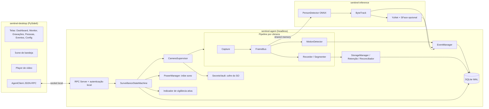
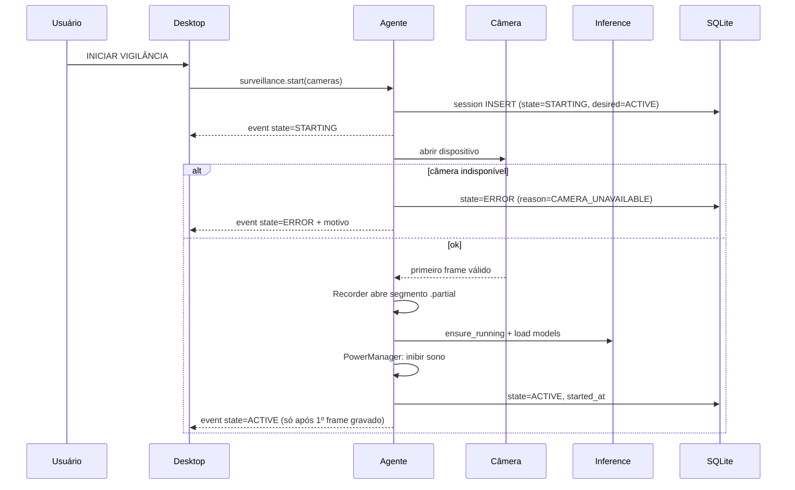
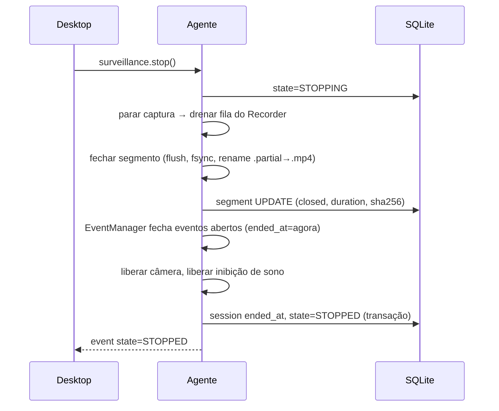
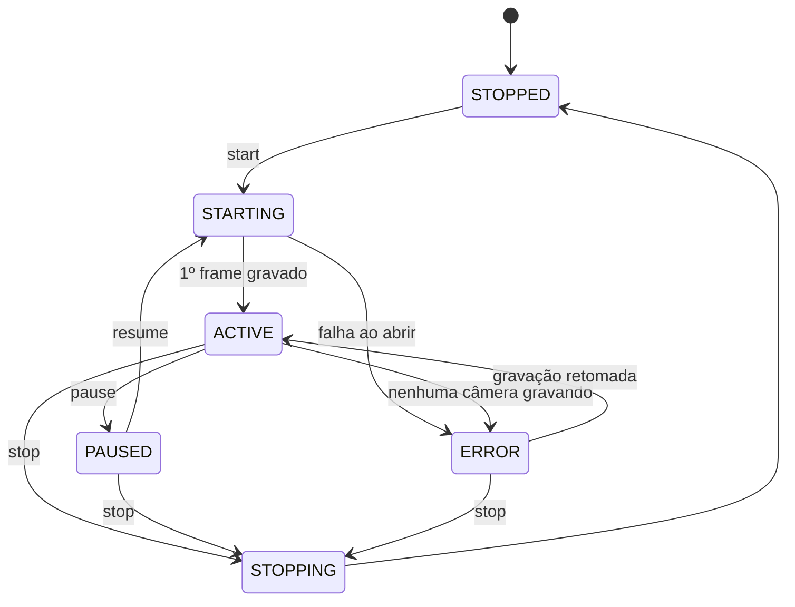

# SENTINEL AI — Fase 1: Arquitetura e Decisões Técnicas

> Status: **APROVADA em 2026-11-09** · Versão 0.3 (decisões do responsável na seção 20)
> Escopo deste documento: planejamento. Nenhum código de produto foi escrito.

Convenção usada neste documento:

- **[CONFIRMADO]**: comportamento documentado pelo fabricante do SO ou amplamente estabelecido.
- **[A VALIDAR]**: hipótese técnica plausível que só será aceita após o teste de hardware da plataforma.
- **[LIMITAÇÃO]**: impedimento do SO/driver que o produto não vai contornar.

---

## 0. Resumo executivo

| Decisão | Escolha |
|---|---|
| Linguagem | **Python 3.12** em todo o produto (agente e interface), com o trabalho pesado em bibliotecas nativas (FFmpeg, OpenCV, ONNX Runtime) |
| Interface | **PySide6 (Qt 6, LGPL)** com QML |
| Captura/gravação | **PyAV (FFmpeg compilado em modo LGPL)** para encode/remux e RTSP; **OpenCV** para captura de webcam local e visão computacional |
| IA | **ONNX Runtime** (CPU por padrão; OpenVINO / CoreML / DirectML / CUDA quando disponíveis) |
| Detector de pessoas | **YOLOX (Apache-2.0)** como padrão; D-FINE / RF-DETR (Apache-2.0) como candidatos de benchmark. **Ultralytics YOLOv8/v11 descartado** por ser AGPL-3.0 |
| Rastreamento | **ByteTrack (MIT)** |
| Reconhecimento facial (opcional) | **YuNet + SFace (OpenCV Zoo, MIT/Apache-2.0)**. Modelos InsightFace descartados: pesos não comerciais |
| Banco | **SQLite 3 em modo WAL**, escritor único (o agente) |
| Comunicação | **JSON-RPC 2.0 sobre socket local** (Named Pipe no Windows, Unix Domain Socket no Linux/macOS), sem porta TCP |
| Segredos | Cofre nativo do SO (Windows Credential Manager/DPAPI, macOS Keychain, Secret Service no Linux) + AES-256-GCM para colunas sensíveis |
| Contêiner de vídeo | **MP4 fragmentado (fMP4)**, segmentos de 5–30 min, resistente a queda de energia |
| Codec | **H.264 pelo encoder do SO/hardware** (Media Foundation, VideoToolbox, VA-API/NVENC/QSV), com OpenH264 como fallback. H.265 opcional, só com encoder de hardware |
| Execução em segundo plano | Agente **na sessão do usuário** (Task Scheduler at-logon / systemd `--user` / LaunchAgent via SMAppService). Serviço de sistema **somente** para câmeras IP |

A conclusão mais importante sobre a tela bloqueada está na seção 12. Em resumo: **bloquear a tela não encerra processos da sessão em nenhum dos três SOs**, então a captura deve continuar. O risco real é o **sono do computador** (Modern Standby no Windows, tampa fechada em notebooks, App Nap/suspensão no macOS) e a **troca rápida de usuário**. O produto vai impedir o sono de forma explícita e visível enquanto vigia. Não vai contornar nenhum mecanismo de privacidade.

---

## 1. Stack recomendada

### 1.1 Recomendação principal: Python + Qt + FFmpeg + OpenCV + ONNX Runtime + SQLite

Justificativa por critério:

| Critério | Como a stack atende |
|---|---|
| 1. Integração com câmeras | OpenCV `VideoCapture` cobre os backends nativos (MSMF no Windows, V4L2 no Linux, AVFoundation no macOS). PyAV/FFmpeg cobre RTSP/HTTP com controle fino de timestamps e reconexão. ONVIF via `onvif-zeep` (MIT) para descoberta e PTZ. |
| 2. Windows/Linux/macOS | Todas as dependências têm wheels oficiais para as três plataformas em x86_64, e para ARM64 no macOS e no Linux. |
| 3. Segundo plano | O agente é um processo Python headless sem Qt GUI. Os mecanismos de autostart são do SO (seção 11). |
| 4. Desempenho de vídeo | Captura, conversão de cor, encode e inferência rodam em C/C++ e **liberam o GIL**. O Python só orquestra, e o fluxo de pixels nunca passa por loops Python. A inferência roda em processo separado (seção 3.3). |
| 5. Modelos de IA | Ecossistema de IA nativo. Os modelos são exportados para ONNX e rodam sem PyTorch em produção, o que economiza cerca de 1,5 GB no instalador. |
| 6. Memória | Estimativa de ~250–450 MB para o agente com 1 câmera 720p e detector pequeno (a medir na Fase 10). A interface Qt fica separada e pode estar fechada. |
| 7. Instaladores | Nuitka (compila para executável nativo) ou PyInstaller. Inno Setup/WiX, AppImage/nfpm, `.app` + DMG. |
| 8. Licenças | PySide6 LGPL (link dinâmico, já atendido pelo empacotamento), OpenCV Apache-2.0, ONNX Runtime MIT, PyAV BSD, FFmpeg **LGPL** (build sem `--enable-gpl`, ou seja, **sem libx264/libx265**), SQLite domínio público. |
| 9. Evolução comercial | Núcleo de domínio puro e testável. O agente pode virar um servidor headless (NVR em mini-PC ou Raspberry Pi) sem reescrita. A interface é substituível porque só fala com o agente via protocolo. Nuitka dificulta a engenharia reversa. |

### 1.2 Pontos fracos assumidos (e mitigação)

- **Empacotamento Python é trabalhoso.** Mitigação: pipeline de build por plataforma desde a Fase 2, e não só na Fase 12.
- **GIL.** Mitigação: o trabalho pesado fica em código nativo e a inferência em processo separado com memória compartilhada.
- **Proteção de código menor que em linguagem compilada.** Mitigação: Nuitka. Se no futuro isso virar requisito comercial forte, o módulo crítico (pipeline de captura) pode ser portado para Rust sem mudar o protocolo.

---

## 2. Comparação das alternativas

| Critério | **Python + Qt** (recomendado) | Rust + Tauri | C# .NET 8 + Avalonia | C++ + Qt |
|---|---|---|---|---|
| Câmeras locais multiplataforma | Ótimo (OpenCV) | Médio (`nokhwa` imaturo; GStreamer-rs bom, mas pesado) | Fraco (sem lib madura multiplataforma; precisaria de FFmpeg.AutoGen) | Ótimo |
| RTSP/encode | Ótimo (PyAV) | Bom (gstreamer-rs / ffmpeg-next) | Médio | Ótimo |
| IA (ONNX) | Ótimo | Bom (`ort` crate) | Bom | Bom |
| Velocidade de desenvolvimento e manutenção | **Alta** | Média-baixa | Média | Baixa |
| Memória/binário | Médio (~150–250 MB instalado) | **Ótimo** (~30–80 MB + modelos) | Médio | Ótimo |
| Interface | Qt nativo, players e tray prontos | Web (WebView). Player de vídeo depende do WebView de cada SO | Avalonia, sem player de vídeo maduro | Qt |
| Instaladores | Médio | **Ótimo** (bundler do Tauri) | Bom | Médio |
| Risco geral | Baixo | Médio (integração de câmera por SO) | Alto (câmeras) | Médio (custo de desenvolvimento) |

**Por que não Rust + Tauri, que é a alternativa mais forte:** ganha em footprint e instaladores, mas perde onde o produto é mais difícil, que é câmera local multiplataforma e visão computacional. Também obriga a manter duas linguagens (Rust e TypeScript) e depende do suporte a codecs de cada WebView para reproduzir vídeo (o WebKitGTK no Linux é notoriamente limitado com H.264). Fica registrado como caminho de evolução para o agente, já que o protocolo IPC isola a troca.

**Por que não Electron:** mais de 200 MB de RAM só para a interface, sem ganho técnico sobre Qt para este produto.

**Por que não PostgreSQL:** instalação local individual com um escritor só. O PostgreSQL exigiria um serviço extra, portas e manutenção sem benefício real. Fica previsto para uma futura edição multi-site/servidor (a camada de repositórios isola o SQL).

---

## 3. Arquitetura geral

### 3.1 Processos

São três processos com fronteiras claras:

1. **`sentinel-agent`**: processo principal e headless. É a autoridade sobre estado, câmeras, gravação, eventos, banco e armazenamento. Nunca depende da interface.
2. **`sentinel-inference`**: processo filho do agente, supervisionado por ele. Roda ONNX Runtime (detecção, tracking e embeddings). Se travar ou estourar memória, é reiniciado **sem afetar a gravação**.
3. **`sentinel-desktop`**: interface PySide6. É só cliente do agente: pode ser aberta e fechada à vontade e **nunca abre a câmera**.

Opcional, a partir da Fase 8:

4. **`sentinel-netservice`**: serviço de sistema (Windows Service / systemd system unit / LaunchDaemon), **só para câmeras IP/RTSP**, para gravar mesmo sem usuário logado. Não acessa webcam (veja a seção 12).

### 3.2 Componentes (mapeamento A–F da especificação)

| Componente | Onde roda | Responsabilidade |
|---|---|---|
| A. Desktop Application | `sentinel-desktop` | Telas, controles, player, tray, diálogo de fechamento |
| B. Background Monitoring Agent | `sentinel-agent` | Máquina de estados, supervisor de câmeras, pipelines de captura, gravador, gerenciador de eventos, retenção, power management |
| C. AI Processing Engine | `sentinel-inference` (+ detecção de movimento dentro do agente) | Movimento (no agente, barato), pessoas, tracking, reconhecimento opcional |
| D. Storage Engine | `sentinel-agent` | Segmentos, thumbnails, índice, recuperação, retenção, reconciliação disco↔banco |
| E. Database Layer | `sentinel-agent` (único escritor) | SQLite WAL, migrações, repositórios, backup |
| F. Communication Layer | agente ↔ UI e agente ↔ inference | JSON-RPC sobre socket local; memória compartilhada para frames |

### 3.3 Pipeline por câmera, dentro do agente

O princípio é que **a gravação nunca espera a IA**.

```
            ┌──────────────┐
 Câmera ───▶│ CaptureThread │──frame + timestamp monotônico──┐
            └──────────────┘                                  │
                                                              ▼
                                                   ┌────────────────────┐
                                                   │ FrameBus (fan-out) │
                                                   └───┬──────────┬─────┘
                       fila limitada, sem descarte     │          │ fila size=1, descarta o mais antigo
                       (backpressure → alarme)         ▼          ▼
                                            ┌──────────────┐  ┌──────────────────┐
                                            │ Recorder     │  │ AnalysisSampler  │ 5 fps → movimento
                                            │ (encode/remux│  │                  │ 2–5 fps → pessoas
                                            │  + segmentos)│  └────────┬─────────┘
                                            └──────┬───────┘           │ shared memory
                                                   ▼                   ▼
                                             disco (fMP4)      sentinel-inference
                                                                       │ resultados
                                                                       ▼
                                                               EventManager → SQLite
```

- **Câmera IP com H.264 nativo:** o Recorder faz **remux sem recodificar** (CPU próxima de zero). Um decoder separado gera frames só na taxa da análise.
- **Webcam local:** os frames chegam crus. O Recorder recodifica com o encoder de hardware do SO.
- Se o encoder não acompanhar (fila do Recorder cheia), isso é **falha de gravação**: o estado `recording_ok=false` vai para a interface e para o log. Nunca há descarte silencioso de vídeo.
- Frames para a IA são descartados de propósito (política *latest-wins*) e contados em métricas (`ai_frames_dropped`).

---

## 4. Diagrama de componentes



## 5. Diagrama de comunicação

### 5.1 Iniciar vigilância



`ACTIVE` só é emitido **depois do primeiro frame gravado com sucesso**. A interface nunca infere estado por conta própria: ela só exibe o que o agente reporta, e se o heartbeat do agente falhar por mais de 3 s, mostra "AGENTE INACESSÍVEL" (nunca o último estado conhecido como se fosse atual).

### 5.2 Parar vigilância



### 5.3 Protocolo

- **Transporte:** Named Pipe `\\.\pipe\sentinel-<SID>` com DACL que só permite o usuário dono (Windows), ou Unix socket em `$XDG_RUNTIME_DIR/sentinel/agent.sock` com modo 0600 (Linux) / `~/Library/Application Support/Sentinel/run/agent.sock` (macOS).
- **Autenticação:** além da permissão do socket, um token aleatório de 256 bits é gerado pelo agente a cada boot e gravado em arquivo legível só pelo usuário. A autenticação é **mútua** (desafio HMAC, sem trafegar o token), feita por conexão numa thread própria para que um cliente lento não bloqueie os demais.
- **Implementação (Fase 2):** `multiprocessing.connection` da biblioteca padrão, que oferece framing por comprimento e desafio HMAC nas três plataformas, sem dependência extra. O token, o lock de instância única e o socket ficam num **diretório de execução privado** (`%LOCALAPPDATA%\SentinelAI\run\<id>` / `$XDG_RUNTIME_DIR/SentinelAI/<id>` / `~/Library/Caches/TemporaryItems/SentinelAI/<id>`), separado do diretório de dados, que pode estar num disco externo com permissões amplas. **Pendência para a Fase 10:** DACL explícita no Named Pipe restrita ao SID do usuário. Hoje o pipe usa o descritor padrão do Windows, e a proteção vem do token.
- **Mensagens:** JSON-RPC 2.0 com framing por comprimento. Há métodos (`surveillance.start/stop/pause/status`, `cameras.*`, `events.query`, `people.*`, `recordings.query`, `storage.*`, `settings.*`) e um canal de assinatura de eventos (`subscribe(["state","camera_health","events"])`).
- **Pré-visualização ao vivo:** canal separado com JPEG em baixa taxa (≤10 fps, configurável). Só existe enquanto a tela de monitoramento está aberta.
- **Agente ↔ inference:** `multiprocessing.shared_memory` para frames e um pipe para comandos e resultados.
- **Rede:** **nenhuma porta TCP é aberta.** Acesso remoto, se um dia existir, será um componente separado, autenticado e desligado por padrão.
- **Versionamento:** o handshake troca `protocol_version`. Se a interface e o agente estiverem em versões incompatíveis, a interface avisa e não opera.

Alternativa avaliada: gRPC. É mais formal (schemas protobuf), mas adiciona um runtime pesado no Python e não traz ganho para comunicação local com duas pontas controladas por nós. JSON-RPC com schemas Pydantic dá validação equivalente.

---

## 6. Máquina de estados da vigilância

### 6.1 Estados (obrigatórios)

| Estado | Significado |
|---|---|
| `STOPPED` | Nenhuma captura. Câmeras liberadas. |
| `STARTING` | Abrindo câmeras, aguardando o primeiro frame gravado. |
| `ACTIVE` | Pelo menos uma câmera **gravando de fato** (o heartbeat do Recorder avançou nos últimos N segundos). |
| `PAUSED` | Pausa **solicitada pelo usuário**. A sessão continua aberta, a captura e a gravação param e a câmera é liberada (o LED apaga). Retomar não cria sessão nova. |
| `STOPPING` | Finalizando segmentos e eventos. |
| `ERROR` | A vigilância foi pedida, mas **nenhuma** câmera está gravando (câmera removida, permissão negada, disco cheio, encoder falhou). A reconexão automática continua tentando e o estado volta a `ACTIVE` quando a gravação for retomada. |

### 6.2 Intenção × realidade

São persistidos **dois campos distintos**:

- `desired_state`: o que o usuário pediu (`ACTIVE` / `PAUSED` / `STOPPED`).
- `observed_state`: o que o agente verifica que está acontecendo.

A interface mostra `observed_state`. Isso impede que ela diga "ativa" com a câmera desconectada.

Saúde por câmera, exibida separadamente (seção 18 da especificação): `connected`, `receiving_frames`, `recording_ok`, `ai_ok`, `last_frame_at`, `last_segment_write_at`, `fps_in`, `fps_ai`, `frames_dropped_ai`.

### 6.3 Transições e retomada



Na inicialização do agente:

- Se `desired_state=ACTIVE` e o agente não foi parado de forma limpa, a sessão anterior é marcada como `INTERRUPTED`, com horário estimado pelo último heartbeat persistido (a cada 5 s). Os segmentos `.partial` passam pela recuperação.
- Se `auto_resume_after_boot=false` (padrão), o estado vira `STOPPED` e a interface mostra: "A vigilância foi interrompida em DD/MM HH:MM (motivo provável: desligamento/reinício). Deseja retomar?".
- Se `auto_resume_after_boot=true`, o agente inicia uma **nova** sessão e registra o vínculo com a interrompida.

### 6.4 Fechamento da interface

O diálogo é obrigatório quando `observed_state ∈ {ACTIVE, PAUSED, STARTING, ERROR}`:

1. **Minimizar para a bandeja**
2. **Fechar a interface e manter a vigilância ativa**
3. **Parar a vigilância e fechar**

Há a opção "lembrar minha escolha" para os itens 1 e 2. **O item 3 nunca é lembrado.** Fechar a interface nunca envia `stop` ao agente.

### 6.5 Indicador visível de vigilância ativa

Ele não depende da interface aberta. O próprio agente mantém um **ícone de bandeja mínimo** (Windows/macOS sempre; Linux quando houver suporte a StatusNotifierItem). Além disso:

- O **LED da câmera** e os **indicadores de privacidade do SO** (barra de tarefas do Windows 11, ponto verde do macOS) permanecem e **não são suprimidos**.
- Uma notificação do SO é exibida ao iniciar e ao parar.

---

## 7. Estrutura de diretórios do código

Adaptada para Python, sem camadas vazias. **Um único pacote** (`src/sentinel`) gerenciado com `uv`. Um workspace com vários pacotes seria uma camada sem ganho nesta fase, e as fronteiras são garantidas pelo `import-linter`. Os pacotes abaixo são criados **só quando a fase correspondente começa**.

```
sentinel-ai/
├── src/sentinel/
│   ├── domain/              # entidades, estados, regras puras (sem I/O): Session, Camera, Event, Person,
│   │                        # SurveillanceStateMachine, RetentionPolicy, EventConsolidator
│   ├── application/         # casos de uso: StartSurveillance, StopSurveillance, RegisterPerson,
│   │                        # ApplyRetention, ReviewMatch… (orquestram domínio + portas)
│   ├── agent/               # entrypoint do processo agente, supervisor, wiring
│   │   ├── capture/         # fontes: local (OpenCV), rtsp (PyAV), file (testes)
│   │   ├── recording/       # encoder/remux, segmentador fMP4, recuperação
│   │   ├── motion/          # background subtraction, ROI, agendas
│   │   ├── events/          # consolidação, deduplicação, thumbnails
│   │   ├── storage/         # layout, retenção, reconciliador, cotas, estimativas
│   │   └── power/           # inibição de sono por SO
│   ├── inference/           # processo de IA: detector, tracker, face, runtime/EPs, pré/pós-processamento
│   ├── persistence/         # SQLite: schema, migrações, repositórios, backup/restauração
│   ├── ipc/                 # protocolo, schemas Pydantic, servidor, cliente, transporte por SO
│   ├── security/            # cofre de segredos, criptografia de colunas, controle de acesso
│   ├── platform/            # windows/, linux/, macos/ — autostart, sessão, notificações, tray
│   ├── desktop/             # interface PySide6
│   │   ├── qml/             # telas e componentes
│   │   ├── viewmodels/
│   │   └── assets/
│   └── common/              # logging estruturado, config, relógio, métricas
├── models/                  # manifest.json (nome, versão, sha256, licença, URL) — binários fora do git
├── tests/
│   ├── unit/                # domínio e aplicação, sem I/O
│   ├── integration/         # SQLite real, FFmpeg real, câmera simulada (arquivo/RTSP local)
│   ├── system/              # agente + UI de ponta a ponta com fontes simuladas
│   └── hardware/            # roteiros e coletores para testes manuais com hardware real
├── packaging/
│   ├── windows/             # Inno Setup / WiX, manifest, script de assinatura
│   ├── linux/               # AppImage, nfpm (deb/rpm), unit systemd
│   └── macos/               # Info.plist, entitlements, helper do LaunchAgent, DMG
├── scripts/                 # build de FFmpeg LGPL, download/verificação de modelos, utilitários
├── docs/                    # este documento, ADRs, guias de usuário e desenvolvedor
├── .github/workflows/       # ci.yml (lint+testes), build-windows.yml, build-linux.yml, build-macos.yml
├── PROJECT_STATUS.md        # acompanhamento (exigido na seção 22 da especificação)
├── README.md · CHANGELOG.md · LICENSE · THIRD_PARTY_LICENSES.md · pyproject.toml · .gitignore
```

Regra de dependência: `domain` não importa nada do projeto; `application` importa só `domain` e define *portas* (interfaces); `agent`, `persistence`, `ipc` e `platform` implementam as portas. `desktop` importa **apenas** `ipc` (cliente) e schemas, **nunca** `agent` ou `persistence`. Isso é verificado no CI com `import-linter`.

---

## 8. Banco de dados

**SQLite 3 em modo WAL**, `foreign_keys=ON`, `synchronous=NORMAL` (FULL nas transações de fechamento de segmento), escritor único no agente e migrações versionadas (`PRAGMA user_version` + scripts SQL).

### 8.1 Esquema (principais tabelas)

```
cameras(id UUID PK, name, kind[local|rtsp|onvif], device_ref, rtsp_url_ref→secret,
        enabled, resolution, fps, codec_pref, quality, created_at, updated_at)
camera_settings(camera_id FK, motion_sensitivity, roi_polygons JSON, schedule JSON,
                min_event_gap_s, ai_fps, person_detection_enabled)
settings(key PK, value JSON, updated_at)                      -- configurações globais
retention_policies(id PK, scope[global|camera], camera_id FK NULL,
                   max_days, max_bytes, min_free_bytes, protect_events BOOL)

surveillance_sessions(id PK, started_at, ended_at, desired_state, observed_state,
                      end_reason[USER_STOP|INTERRUPTED|ERROR], last_heartbeat_at,
                      resumed_from_session_id FK NULL)
session_cameras(session_id FK, camera_id FK)

recordings(id PK, session_id FK, camera_id FK, started_at, ended_at)   -- trecho contínuo
segments(id PK, recording_id FK, camera_id FK, path_rel UNIQUE, status
         [WRITING|CLOSED|RECOVERED|CORRUPT|DELETING], start_ts, end_ts, duration_ms,
         bytes, codec, width, height, fps, sha256, protected BOOL, created_at)

events(id PK, camera_id FK, session_id FK, type[MOTION|PERSON|CAMERA_LOST|...],
       started_at, ended_at, peak_confidence, max_people, thumbnail_rel,
       primary_segment_id FK, offset_ms, person_id FK NULL, review_status
       [NONE|PENDING|CONFIRMED|REJECTED], protected BOOL)
event_segments(event_id FK, segment_id FK)     -- evento pode atravessar segmentos
detections(id PK, event_id FK, ts, track_id, class, confidence, bbox JSON)  -- amostrado, não por frame

people(id UUID PK, name_enc, description_enc, created_at, consent_id FK,
       first_seen_at, last_seen_at, appearance_count)
consents(id PK, person_id FK, granted_at, granted_by, scope, revoked_at, evidence_note)
person_references(id PK, person_id FK, image_rel, embedding_enc BLOB, model_version, created_at)
match_reviews(id PK, event_id FK, candidate_person_id FK, score, decided_by, decided_at, decision)

operation_log(id PK, ts, actor[user|agent|system], action, target, details JSON)  -- sem dados sensíveis
schema_migrations(version PK, applied_at)
```

### 8.2 Índices e integridade

Índices: `events(camera_id, started_at)`, `events(type, started_at)`, `events(person_id)`, `segments(camera_id, start_ts)`, `segments(status)`, `detections(event_id)`.

- `ON DELETE` explícito em cada chave. Exemplo: excluir uma pessoa apaga `person_references` e `consents` em cascata e define `events.person_id=NULL`, mantendo o evento anônimo.
- `appearance_count`, `first_seen_at` e `last_seen_at` são atualizados **na consolidação do evento**, na mesma transação, e recalculáveis com uma query de verificação (teste de consistência).
- Arquivos grandes **ficam fora do banco**, que guarda só caminhos relativos à raiz de dados. Isso permite mover a pasta de dados para outro disco. A exceção são os embeddings (512 floats, cerca de 2 KB, criptografados), que ficam no banco por serem pequenos e sensíveis.

### 8.3 Backup e restauração

- **Backup:** API de backup online do SQLite (`sqlite3.backup`), sem parar o agente, mais um pacote `.sentinel-backup` (zip) com banco, configurações e referências de pessoas, **criptografado com AES-256-GCM** usando chave derivada de senha (scrypt). Vídeos não entram por padrão (opção separada).
- **Restauração:** só com a vigilância `STOPPED`. Valida a versão do esquema, migra se necessário e roda o reconciliador.
- Há backup automático diário do banco em `backups/`, com rotação dos últimos 7.

---

## 9. Armazenamento

### 9.1 Layout do diretório de dados

Configurável, inclusive em outro disco. Padrões: `%LOCALAPPDATA%\SentinelAI`, `~/.local/share/sentinel-ai` e `~/Library/Application Support/SentinelAI`.

```
SENTINEL_DATA/
├── database/sentinel.db (+ -wal, -shm)
├── recordings/<camera_uuid>/2026/11/09/
│       14-00-00_000123.mp4            # segmento fechado
│       14-15-00_000124.mp4.partial    # em gravação
├── events/<camera_uuid>/2026/11/09/<event_id>.jpg   # imagem de destaque
├── thumbnails/<camera_uuid>/…                       # miniaturas da linha do tempo
├── people/<person_uuid>/reference/<ref_id>.jpg.enc  # imagens de referência criptografadas
├── models/<model_name>/<version>/model.onnx
├── configuration/agent.toml          # bootstrap (caminho do banco, nível de log); o resto fica no banco
├── logs/agent-YYYY-MM-DD.jsonl
└── backups/
```

Diferenças em relação à sugestão da especificação, de propósito:

- Não há `people/<id>/events/` nem `unknown_events/`. O vínculo evento↔pessoa vive **só no banco**. Duplicar isso em pastas criaria duas fontes de verdade, contra o próprio requisito da especificação.
- O identificador de câmera é o UUID, e não `camera_001`, para não mudar o caminho se a câmera for renomeada ou recriada.

### 9.2 Gerenciamento de espaço e retenção

O job roda a cada 10 min e também é disparado por alarme de espaço baixo:

1. Calcula o uso por câmera e o espaço livre no volume.
2. Seleciona candidatos: `segments.status=CLOSED AND protected=0`, de sessões que não estejam no segmento corrente, e com `protect_events` respeitado (segmentos ligados a eventos protegidos ficam).
3. Ordena por `start_ts` crescente e exclui até satisfazer **todas** as regras: `max_days`, `max_bytes` e `min_free_bytes`.
4. Exclusão em duas fases, resistente a queda: `UPDATE status='DELETING'` → `os.remove` → `DELETE FROM segments` + `operation_log`, tudo dentro da transação.
5. **Nunca** toca em segmento `WRITING`/`.partial`. O Recorder mantém um *lease* explícito no segmento corrente.

Se só restarem arquivos protegidos e o disco continuar abaixo do mínimo, a gravação **não apaga nada protegido**: ela gera o alarme `STORAGE_CRITICAL` e, no limite (por exemplo, 1 GB livre), entra em `ERROR` com motivo claro.

**Reconciliador** (na inicialização e diariamente):

- Arquivo sem linha no banco (órfão): é movido para `recordings/_orphans/` e reportado. Não é apagado automaticamente.
- Linha no banco sem arquivo: o segmento é marcado `MISSING` e os eventos ligados são sinalizados.
- `DELETING` pendente: a exclusão é concluída.
- `.partial`: vai para a recuperação (seção 10.4).

### 9.3 Estimativas de consumo (H.264, cena típica interna)

| Perfil | Bitrate médio | Por hora | Por dia |
|---|---|---|---|
| 640×480 @ 10 fps | ~0,4 Mbps | ~0,18 GB | ~4,3 GB |
| 1280×720 @ 15 fps | ~1,2 Mbps | ~0,55 GB | ~13 GB |
| 1920×1080 @ 15 fps | ~2,5 Mbps | ~1,1 GB | ~27 GB |
| 1920×1080 @ 15 fps H.265 | ~1,4 Mbps | ~0,63 GB | ~15 GB |

Esses valores são teóricos (VBR com teto). A interface mostra a **média real medida** das últimas 24 h por câmera e projeta quantos dias cabem no limite configurado.

---

## 10. Estratégia de gravação contínua

### 10.1 Dois mecanismos independentes

- **Gravação contínua:** o Recorder grava **todo** o tempo em `ACTIVE`, sem depender de movimento.
- **Eventos:** o EventManager só cria **referências** (`event_segments` + `offset_ms`) para o vídeo contínuo. Não há cópia de vídeo por evento, e assim um evento nunca perde imagem por estar "fora" da gravação.

### 10.2 Contêiner e segmentação

- **MP4 fragmentado** (`movflags=frag_keyframe+empty_moov+default_base_moof`, fragmento ≈ 1–2 s). Mesmo se o processo morrer ou a energia cair, o arquivo é legível até o último fragmento. Com MP4 comum, o `moov` só é escrito no final, e um arquivo cortado fica ilegível.
- **Duração do segmento:** 5/10/15/30 min (padrão 15). O corte acontece **em keyframe**, com GOP fixo (por exemplo, 2 s) para o corte ser preciso.
- **Nome:** `HH-MM-SS_<seq>.mp4.partial` durante a escrita. No fechamento, `flush` → `fsync` → `rename` atômico → `fsync` do diretório → `UPDATE status=CLOSED`.
- **Timestamps:** relógio monotônico para PTS e relógio de parede registrado no banco no início de cada segmento. Isso dá continuidade mesmo com ajuste de horário/NTP.
- **Lacunas:** se a câmera cair, o segmento atual é fechado e um novo é aberto na reconexão. A lacuna fica explícita no banco (`CAMERA_LOST` → `CAMERA_RESTORED`) e na linha do tempo.

### 10.3 Codecs e licenciamento

| Opção | Uso | Observação |
|---|---|---|
| H.264 via **encoder do SO/hardware** (Media Foundation, VideoToolbox, VA-API, QSV, NVENC, AMF) | **Padrão** | Baixo uso de CPU. O royalty de patente do encoder é coberto pela licença do SO/fabricante (verificar com assessoria jurídica antes da venda). |
| H.264 via **OpenH264** (Cisco, BSD) | Fallback por software | O binário oficial da Cisco vem com licença de patente paga por ela, mas deve ser baixado do servidor da Cisco (não embutido) para manter esse benefício. Qualidade inferior ao x264. |
| H.264 via libx264 | **Não usado** | GPL, incompatível com distribuição comercial fechada. |
| H.265 | Opcional | Só com encoder de hardware disponível. O pool de patentes é mais complexo e a reprodução não é universal (Windows exige extensão HEVC). |
| Câmera IP | Remux do stream original | Não recodifica nem altera qualidade, e o custo de CPU é mínimo. |

Configuráveis: resolução, FPS, qualidade (CRF/CQ ou bitrate-alvo com teto), GOP e duração do segmento.

### 10.4 Recuperação de gravações incompletas

Na inicialização, para cada `.partial`:

1. `ffprobe` lê fragmentos até o último íntegro.
2. Se houver ≥1 fragmento válido, faz remux para um `.mp4` limpo, marca `RECOVERED` com a duração real e registra no `operation_log`.
3. Se não houver nenhum, marca `CORRUPT`, move para `_corrupt/` e reporta.

Fechamento normal: valida com `ffprobe` (duração e contagem de frames coerentes com o esperado) e calcula SHA-256 em segundo plano (para detectar adulteração e corrupção posterior).

### 10.5 Reprodução

O player Qt (`QMediaPlayer`, backend FFmpeg no Qt 6.5+) reproduz segmentos fechados. A linha do tempo junta segmentos contíguos, com marcadores de eventos e lacunas. Exportação de trecho: remux sem recodificar com corte em keyframe, ou recodificação precisa (opcional). Cada exportação é registrada no `operation_log`.

---

## 11. Estratégia de detecção e IA

### 11.1 Detecção de movimento (no agente, barata)

- Frame reduzido (por exemplo, 320 px de largura) em escala de cinza, com blur gaussiano.
- **MOG2** (background subtraction adaptativo) com detecção de sombra ativada (sombras recebem valor 127 e são descartadas).
- Morfologia (abertura e fechamento), contornos e filtro por área mínima relativa.
- **Máscara de ROI** (polígonos desenhados na interface) e **agenda** por câmera.
- **Detector de mudança global de iluminação:** se mais de X% da imagem muda ao mesmo tempo com variação uniforme de luminância, o evento é classificado como `LIGHTING_CHANGE` e não como movimento, e o modelo de fundo é reiniciado.
- **Histerese:** o evento só abre após N amostras consecutivas acima do limiar e fecha após `cooldown` segundos sem movimento. Movimentos com intervalo menor que `min_event_gap_s` se fundem no mesmo evento. Isso resolve o requisito de "um movimento contínuo não gera centenas de eventos".
- A sensibilidade (1–10) é mapeada para limiar de área, `varThreshold` e N.

### 11.2 Detecção de objetos e pessoas (processo `sentinel-inference`)

- **Modelo padrão:** YOLOX-Tiny/YOLOX-S em ONNX (Apache-2.0), entrada 416–640, classes COCO úteis: `person`, `cat`, `dog`, `bird`, `car`, `motorcycle`, `bicycle`, `truck`. Com isso o sistema diferencia pessoas, animais e veículos. As demais classes são ignoradas.
- **Candidatos para a Fase 6:** D-FINE-N e RF-DETR-Nano (ambos Apache-2.0). Fica o que tiver melhor relação precisão×latência na CPU de referência.
- **Descartado:** Ultralytics YOLOv5/v8/v11. Tecnicamente são excelentes, mas são **AGPL-3.0**, o que obrigaria a abrir o código do produto ou comprar a licença Enterprise. Se o projeto quiser essa licença no futuro, a troca é só de arquivo de modelo e pós-processamento.
- **Disparo:** o detector roda a 2–5 fps (configurável) **sempre que houver movimento** e a 0,5 fps em modo "vigia" para pegar pessoas paradas. Isso reduz bastante a CPU em cena estática.
- **Execution Providers:** CPU (padrão, sempre disponível); OpenVINO (Intel CPU/iGPU); CoreML (Apple Silicon); DirectML (Windows, qualquer GPU DX12); CUDA (NVIDIA, pacote opcional à parte por tamanho). Na inicialização roda um micro-benchmark, e se um EP falhar o sistema volta para CPU automaticamente e registra o motivo.
- **Quantização INT8** dos modelos para CPU (validando a perda de precisão no conjunto de teste).

### 11.3 Rastreamento

- **ByteTrack** (MIT) sobre as detecções, com `track_id` **temporário e por câmera**, que expira após T segundos sem ser visto.
- Uso: consolidar a **presença** ("1 episódio com 2 pessoas, 14:02:10–14:03:55"), contar `max_people` e evitar eventos duplicados. **O track_id não representa identidade e não é persistido entre episódios.**

### 11.4 Consolidação de eventos (deduplicação)

O evento `PERSON` começa no primeiro track confirmado (≥ K detecções) e termina quando não há track ativo por `cooldown`. Movimento contínuo e presença simultâneos geram **um** evento `PERSON` (o de movimento fica subordinado). A imagem de destaque é o frame de maior confiança × área de bbox do episódio. `detections` é gravada de forma amostrada (no máximo 1 por segundo por track) para não inflar o banco.

### 11.5 Reconhecimento de pessoas cadastradas (opcional, desligado por padrão)

- **Pipeline:** crop da pessoa → **YuNet** (detecção facial, MIT) → alinhamento → **SFace** (embedding de 128-d, Apache-2.0).
- **Descartados:** modelos pré-treinados do InsightFace/ArcFace (licença **não comercial**) e reconhecimento de corpo inteiro (ReID), que não é confiável para identidade.
- **Cadastro:** só com **registro de consentimento** (tabela `consents`: data, responsável, escopo). Requer 3–10 imagens de referência.
- **Matching com dois limiares configuráveis:**
  - `score ≥ alto`: associação automática.
  - `baixo ≤ score < alto`: o evento vai para a **fila de revisão manual**, sem associação.
  - `score < baixo`: evento anônimo.
- **Pessoas desconhecidas:** o embedding é calculado **só em memória** para comparar e descartado em seguida. **Nenhum** embedding, recorte facial ou "perfil" de desconhecido é persistido, e não existe agrupamento automático de rostos desconhecidos.
- **Contagem de aparições:** +1 por **evento consolidado** associado (confirmado automaticamente ou na revisão), nunca por frame.
- **Exclusão de pessoa:** apaga referências, embeddings, arquivos (sobrescrita + remoção) e consentimento, e desvincula os eventos (que ficam anônimos). Tudo é registrado em `operation_log` sem dados pessoais.

### 11.6 Operação offline

Os modelos vêm no instalador (ou num pacote de modelos), com `models/manifest.json` contendo SHA-256 e licença de cada um. Nada essencial depende de rede ou de API paga.

---

## 12. Execução em segundo plano e com a tela bloqueada

Esta é a seção crítica. Separo três situações que costumam ser confundidas:

| Situação | O que acontece com processos da sessão |
|---|---|
| **Tela bloqueada** (Win+L, Ctrl+Cmd+Q, bloqueio do GNOME/KDE) | A sessão continua viva e os processos continuam rodando. |
| **Sono/suspensão/hibernação** (incluindo Modern Standby e tampa fechada) | A CPU para ou fica restrita. **Nenhum software grava** nesse estado. |
| **Logoff / troca rápida de usuário / reinício** | Logoff e reinício encerram os processos da sessão. A troca rápida mantém a sessão, mas pode tirar o acesso a dispositivos. |

**O produto garante a primeira, impede a segunda com o consentimento visível do usuário e documenta os limites da terceira.**

### 12.1 Windows 10 e 11

**Arquitetura:** o agente roda **na sessão interativa do usuário** (não na Session 0), registrado no **Agendador de Tarefas** com gatilho "ao fazer logon" deste usuário, "reiniciar em caso de falha" e "não parar se em bateria". Alternativa: chave `HKCU\…\Run`.

**Por que não um Windows Service para a webcam:**

- Serviços rodam na **Session 0**, isolada, sem desktop interativo.
- O acesso à câmera passa pelo **Windows Camera Frame Server** e pelas **configurações de privacidade de câmera por usuário** ("Permitir que aplicativos da área de trabalho acessem a câmera"). Um serviço como `LocalSystem` está fora desse modelo de consentimento por usuário. Mesmo que funcione em algum driver, não é um cenário suportado nem previsível, e na prática seria uma forma de contornar o controle de privacidade. **[LIMITAÇÃO: não usaremos]**

**Bloqueio de tela:**

- **[CONFIRMADO]** Bloquear (Win+L ou bloqueio por inatividade) não encerra nem suspende aplicativos desktop Win32 da sessão.
- **[A VALIDAR]** Se o Media Foundation/Frame Server continua entregando frames da webcam integrada com a sessão bloqueada. O esperado é que sim (é o comportamento comum de apps de gravação), mas varia com o driver. Também é preciso verificar se o **Windows Hello** compartilha o sensor RGB na tela de bloqueio, o que é raro (o Hello usa o sensor IR) mas existe em alguns notebooks.

**Risco principal, o sono:**

- Em máquinas com **Modern Standby (S0ix)**, a maioria dos notebooks atuais, quando a tela apaga após o bloqueio o sistema pode entrar em standby conectado e o **Desktop Activity Moderator suspende apps desktop**. A captura para.
- **Mitigação:** com a vigilância `ACTIVE`, o agente emite `PowerCreateRequest` + `PowerSetRequest(PowerRequestSystemRequired)` (aparece em `powercfg /requests` com o motivo "Sentinel AI: vigilância ativa", o que dá transparência). Se o teste mostrar que isso não basta em Modern Standby, a opção configurável é `PowerRequestDisplayRequired`: a tela fica ligada, mas bloqueada.
- **Tampa fechada:** é configuração do usuário no Windows ("Ao fechar a tampa: Não fazer nada"). O app **detecta e avisa**, mas não altera sozinho uma configuração do sistema.
- **Em bateria:** um aviso sugere manter o notebook na tomada.

**Logoff:** encerra o agente. É **[LIMITAÇÃO]** para webcam. A alternativa suportada é o `sentinel-netservice` (Windows Service) para **câmeras IP**, que não dependem do modelo de privacidade da webcam porque são acesso de rede.

**Troca rápida de usuário:** **[A VALIDAR]**. A sessão do primeiro usuário continua, mas o compartilhamento de câmera entre sessões depende do Frame Server. Se outro usuário abrir a câmera, o comportamento precisa ser medido. O agente detecta perda de frames e entra em `ERROR` com motivo, sem fingir `ACTIVE`.

**Permissões:** na primeira execução, o app verifica a chave de privacidade de câmera e, se estiver negada, abre `ms-settings:privacy-webcam`. Políticas de grupo corporativas podem bloquear a câmera, e o app apenas informa.

### 12.2 Linux

**Arquitetura:** **systemd user service** (`~/.config/systemd/user/sentinel-agent.service`, `Restart=on-failure`). Para rodar **sem login gráfico** (por exemplo, mini-PC dedicado), há a opção `loginctl enable-linger <usuário>`, que exige confirmação do usuário e senha de administrador.

**Câmera:**

- **[CONFIRMADO]** V4L2 não tem relação com o bloqueio de tela. O screen locker do GNOME/KDE não afeta processos nem `/dev/video*`.
- **Permissão (detalhe crítico):** em várias distribuições o acesso a `/dev/video*` é concedido por **ACL dinâmica do logind (`uaccess`) só à sessão local ativa**. Com a tela bloqueada a sessão continua ativa, então o acesso é mantido. Na **troca de usuário** ou **sem sessão (linger)**, a ACL sai, e a solução suportada é colocar o usuário no grupo `video` (`usermod -aG video`, com instrução clara na interface).
- **Sono:** inibidor via logind `Inhibit("sleep:idle", "Sentinel AI", "vigilância ativa", "block")`. É visível em `systemd-inhibit --list`. A tampa fechada segue `HandleLidSwitch` do logind, e o app avisa.
- **Wayland/Flatpak:** a versão nativa (DEB/RPM/AppImage) acessa V4L2 direto. Num eventual Flatpak, o acesso passaria pelo portal de câmera (PipeWire), o que fica fora do escopo inicial.
- **Segredos sem login:** no modo linger o Secret Service (GNOME Keyring/KWallet) pode estar **bloqueado**. É **[LIMITAÇÃO]** documentada. Nesse modo, as credenciais RTSP usam um arquivo criptografado com chave em arquivo 0600 ou TPM (`systemd-creds`), quando disponível.

### 12.3 macOS

**Arquitetura:** **LaunchAgent** registrado via **`SMAppService.agent`** (macOS 13+), com o executável do agente **dentro do bundle `.app`** (Login Item helper), `KeepAlive=true` e `ProcessType=Interactive`.

**Câmera e TCC:**

- **[CONFIRMADO]** O acesso à câmera exige permissão TCC concedida pelo usuário, atribuída ao app/bundle responsável. Requisitos: `NSCameraUsageDescription` no Info.plist, a entitlement `com.apple.security.device.camera` com Hardened Runtime, assinatura Developer ID e notarização. Sem assinatura consistente, a permissão é perdida a cada atualização.
- **LaunchDaemon não será usado para a câmera.** Daemons rodam fora da sessão Aqua e fora do modelo TCC do usuário. **[LIMITAÇÃO]** Pode ser usado só para o `sentinel-netservice` (câmeras IP).
- **Bloqueio de tela:** **[A VALIDAR]**. O esperado é que um processo com `AVCaptureSession` ativo continue recebendo frames com a tela bloqueada enquanto o Mac não dorme. É obrigatório monitorar `AVCaptureSessionWasInterruptedNotification`/erros de runtime e refletir isso no estado.
- **Troca rápida de usuário:** **[A VALIDAR, provável limitação]**. Espera-se que o macOS entregue a câmera ao usuário que está no console e interrompa a sessão de fundo.
- **Sono e App Nap:** `IOPMAssertionCreateWithName(kIOPMAssertPreventUserIdleSystemSleep)`, visível em `pmset -g assertions`, e `NSProcessInfo.beginActivity(.userInitiated | .idleSystemSleepDisabled)` para desativar o App Nap. A **tampa fechada coloca o MacBook para dormir** (exceto em modo clamshell com monitor externo e energia): é **[LIMITAÇÃO]** documentada, sem contorno.
- O **indicador verde** de câmera do macOS continua visível, por design.

### 12.4 Matriz de viabilidade (expectativa antes dos testes)

| Cenário | Windows 10/11 | Linux (X11/Wayland) | macOS 13+ |
|---|---|---|---|
| UI minimizada/fechada, agente ativo | ✅ arquitetura | ✅ arquitetura | ✅ arquitetura |
| Tela bloqueada, sem sono | 🟡 esperado ✅ — validar driver/Frame Server | ✅ (V4L2 independe do locker) | 🟡 esperado ✅ — validar |
| Tela apagada após o bloqueio | 🟡 depende de Modern Standby + power request — validar | ✅ com inibidor de sono | ✅ com assertion |
| Suspensão/hibernação | ❌ ninguém grava | ❌ | ❌ |
| Tampa fechada | 🟡 só se o usuário configurar "não fazer nada" | 🟡 depende de `HandleLidSwitch` | ❌ (exceto clamshell) |
| Troca rápida de usuário | 🟡 validar | 🟡 só com grupo `video` | ❌ provável |
| Logoff / sem usuário logado — webcam | ❌ | 🟡 com linger + grupo `video` | ❌ |
| Logoff / sem usuário logado — câmera IP | ✅ via Windows Service | ✅ via system unit | ✅ via LaunchDaemon |
| Reinício com retomada automática | ✅ após logon (opção desligada por padrão) | ✅ (com linger, mesmo sem logon) | ✅ após logon |

### 12.5 Alternativas oficialmente suportadas se a webcam integrada não ficar acessível

1. **Câmera IP/RTSP** gravada pelo serviço de sistema: não depende de sessão, de TCC nem da privacidade da webcam.
2. **Câmera USB externa** no Linux com o usuário no grupo `video`: funciona com tela bloqueada e em linger.
3. **Dispositivo dedicado** (mini-PC ou Raspberry Pi 5 com Linux) rodando o agente headless. A interface desktop se conecta a ele numa evolução futura com acesso remoto autenticado (fora do escopo inicial).
4. **Manter a sessão desbloqueada** não é uma alternativa recomendada. O produto **não** vai sugerir nem automatizar a desativação do bloqueio.

### 12.6 Protocolo do teste de tela bloqueada (por plataforma)

Automatizado onde possível com o script `tests/hardware/locked_session_test.py`:

1. Registrar o ambiente: SO/build, modelo, driver da câmera, energia (AC/bateria), Modern Standby (`powercfg /a`), configurações de tela e tampa.
2. Abrir o app e iniciar a vigilância. Confirmar `ACTIVE`, frames chegando e o segmento crescendo.
3. Colocar à frente da câmera um **relógio de referência** (tela de celular com cronômetro), que serve como prova visual da continuidade.
4. Bloquear o computador. **Variante A:** tela ligada. **Variante B:** aguardar a tela apagar pela política de energia.
5. Aguardar ≥ 15 min (recomendado: 30 min e uma rodada de 8 h). Durante o bloqueio, uma pessoa passa em frente à câmera em horários anotados (T+3, T+9 e T+14 min).
6. Desbloquear.
7. Verificações automáticas:
   - `ffprobe` em cada segmento: íntegro, duração e contagem de frames ≈ fps × duração (tolerância de 2%).
   - **Continuidade:** nenhuma lacuna maior que 2 s entre PTS de segmentos consecutivos.
   - Heartbeats do Recorder no banco sem buracos.
   - Os eventos `PERSON` nos horários anotados existem (±10 s).
   - `powercfg /requests`, `systemd-inhibit --list` ou `pmset -g assertions` capturados durante o teste.
8. Verificação manual: abrir o vídeo no instante do bloqueio e nos horários anotados e conferir o cronômetro filmado.
9. Registrar o resultado em `PROJECT_STATUS.md` (matriz de compatibilidade) com evidências anexadas.

Um teste em VM ou com câmera simulada **não substitui** este teste. Se falhar, a limitação é documentada no README e na própria interface (aviso ao iniciar a vigilância naquela plataforma).

---

## 13. Câmeras IP e segurança eletrônica

- **Tipos:** `local` (índice/ID do dispositivo, com nome estável quando o SO expõe: symlink `by-id` no Linux, *symbolic link* MF no Windows, `uniqueID` no AVFoundation), `rtsp` (URL + credenciais) e `onvif` (descoberta WS-Discovery na rede local **sob demanda**, perfil S para obter o stream RTSP).
- **Credenciais:** **nunca no banco em texto puro.** O banco guarda só uma referência (`secret_ref`), e a senha fica no cofre do SO via biblioteca `keyring`. URLs com senha embutida são reescritas antes de qualquer log (redação automática).
- **Reconexão:** backoff exponencial com jitter (1 s → 60 s máx.), detecção de perda de sinal por timeout de frame (por exemplo, 5 s sem frame vira `CAMERA_LOST`), restauração automática e evento `CAMERA_RESTORED`.
- **Múltiplas fontes:** um pipeline por câmera, com isolamento de falhas (uma câmera travada não bloqueia as outras) e um orçamento de IA compartilhado com escalonamento *round-robin* entre câmeras.
- **Configuração por câmera:** resolução, fps, qualidade, ROI, agenda, sensibilidade, IA on/off.

---

## 14. Segurança e privacidade

| Requisito | Implementação |
|---|---|
| Processamento local | Padrão, sem telemetria. Atualizações e envio de diagnóstico são opt-in. |
| Nenhum envio de imagens | Não há nenhum código de upload no produto base. |
| Credenciais | Cofre nativo do SO. Redação automática nos logs. |
| Controle de acesso | Socket restrito ao usuário + token. PIN/senha opcional para abrir a interface e para ações sensíveis (excluir gravações, exportar, ver pessoas, desligar vigilância). |
| Criptografia | Colunas sensíveis (nomes, descrições, embeddings) e imagens de referência em AES-256-GCM, com chave mestra no cofre do SO. Criptografia de vídeo em repouso fica opcional na Fase 10 (custo de CPU e de compatibilidade de reprodução). A recomendação é BitLocker/FileVault/LUKS, documentada. |
| Biometria | Desligada por padrão. Consentimento registrado, finalidade declarada, sem perfis de desconhecidos e exclusão definitiva. |
| Exclusão definitiva | Remoção de linhas + arquivos + `VACUUM` agendado. Limitação documentada: sobrescrita não garante apagamento físico em SSD. Para isso, recomenda-se criptografia de disco. |
| Logs | JSON estruturado, sem imagens, nomes de pessoas, credenciais ou URLs com senha. Rotação e retenção de 30 dias. |
| Backup | Criptografado com senha (seção 8.3). |
| Indicadores visíveis | Ícone de bandeja do agente, notificações e LED/indicadores do SO **nunca suprimidos**. |
| Antivigilância oculta | Não há modo invisível nem ocultação de processo. O agente aparece com nome claro no Gerenciador de Tarefas, Monitor de Atividade e `ps`. |
| Áudio | **Não é gravado** na versão inicial. Gravação de áudio ambiente tem implicações legais mais severas (interceptação de comunicações). Se um dia existir, será opt-in com aviso explícito. |
| LGPD | Imagem é dado pessoal e biometria é **dado pessoal sensível** (art. 5º, II, e art. 11). O produto oferece: tela de aviso na primeira execução, registro de consentimento, exportação e exclusão dos dados de uma pessoa (direitos do titular, art. 18), retenção configurável e minimização (anônimo por padrão). A responsabilidade pelo uso, como controlador, é do operador. O texto jurídico final deve ser revisado por advogado. |

---

## 15. Estratégia de distribuição

| Plataforma | Artefatos | Assinatura | Agente |
|---|---|---|---|
| Windows 10/11 x64 | Instalador **EXE (Inno Setup)**, **MSI (WiX)** para implantação corporativa, **ZIP portátil** (sem autostart; o agente roda enquanto a pasta existir) | Authenticode (certificado OV/EV ou Azure Trusted Signing) para evitar o SmartScreen | Tarefa agendada por usuário. Serviço opcional para câmeras IP |
| Windows ARM64 | **[A VALIDAR]** Depende de wheels ARM64 de OpenCV/ONNX Runtime/PyAV. Fallback: build x64 rodando em emulação Prism, declarado como tal | idem | idem |
| Linux x86_64 / ARM64 | **AppImage** (universal), **DEB** e **RPM** (via `nfpm`) | Assinatura GPG dos pacotes | systemd user unit instalada pelo pacote ou criada pelo app (AppImage) |
| macOS 13+ arm64 / x86_64 | **.app** + **DMG**. Build *universal2* ou dois builds separados | Developer ID + Hardened Runtime + **notarização** + staple | LaunchAgent via SMAppService |

- **Empacotador:** começamos com **PyInstaller** (maduro, rápido de iterar) e avaliamos o **Nuitka** na Fase 12 (desempenho de inicialização, proteção de código).
- **FFmpeg:** build próprio LGPL por plataforma (script versionado em `scripts/`), com as flags de configuração publicadas em `THIRD_PARTY_LICENSES.md`, como a LGPL exige.
- **Modelos** dentro do instalador, verificados por SHA-256 no primeiro uso.
- **CI:** um workflow por SO no GitHub Actions (runners Windows, Ubuntu e macOS arm64), com testes unitários e de integração em cada push e artefatos assinados em tags. **Nenhuma plataforma é declarada suportada sem build + teste de hardware registrado.**
- **Atualizações:** verificação opt-in. A atualização preserva os dados e o consentimento TCC (mesma identidade de assinatura no macOS).

---

## 16. Requisitos de hardware (preliminares; serão medidos na Fase 10)

| Perfil | CPU | RAM | Disco | Cenário |
|---|---|---|---|---|
| Mínimo | 4 núcleos x86_64 (~2016+) ou Apple M1 | 8 GB | 50 GB livres (≈ 3–4 dias a 720p) | 1 câmera 720p@15, IA na CPU a 2 fps |
| Recomendado | 6+ núcleos ou iGPU Intel/AMD recente ou Apple Silicon | 16 GB | 500 GB+ (de preferência disco dedicado) | 2–4 câmeras, IA a 5 fps via OpenVINO/CoreML/DirectML |
| Avançado | GPU NVIDIA com CUDA | 16–32 GB | 2 TB+ | 8+ câmeras IP |

Sistemas operacionais: Windows 10 22H2+ / Windows 11; Ubuntu 22.04+ / Fedora 39+ / Debian 12+ (systemd obrigatório); macOS 13 Ventura+. Requisito adicional: encoder H.264 de hardware recomendado (presente em praticamente toda máquina pós-2015).

---

## 17. Limitações técnicas conhecidas

1. **Nenhum software grava com o computador dormindo, suspenso ou hibernado.** O produto inibe o sono enquanto vigia, mas não sobrepõe uma ação explícita do usuário (fechar a tampa, desligar) nem uma política de TI.
2. **Webcam sem usuário logado** não é suportada no Windows nem no macOS (modelo de privacidade). No Linux, só com linger + grupo `video`.
3. **Troca rápida de usuário** pode interromper a webcam (validar por SO). O produto detecta e informa.
4. **Comportamento com a tela bloqueada é dependente do driver** no Windows e precisa de validação no macOS. Resultados por modelo serão registrados.
5. **Desempenho de IA na CPU** limita o número de câmeras analisadas a 5 fps. A gravação não é afetada.
6. **Reconhecimento facial** depende de rosto visível, iluminação e ângulo. SFace é menos preciso que modelos não comerciais de ponta. Por isso o padrão é revisão manual em casos duvidosos.
7. **Diferenciação de sombras e iluminação** é heurística. Haverá falsos positivos residuais de movimento (mitigados porque eventos de pessoa dependem do detector, não só de movimento).
8. **Exclusão "definitiva" em SSD** não garante apagamento físico sem criptografia de disco.
9. **Windows ARM64** depende da disponibilidade de wheels nativos.
10. **Linux em modo linger:** o cofre de senhas pode estar indisponível, e é usado fallback com `systemd-creds`/arquivo protegido.
11. **H.265** depende de hardware e, no Windows, da extensão HEVC para reprodução fora do app.

---

## 18. Plano de testes

### 18.1 Camadas

| Camada | Ferramentas | O que cobre | Roda no CI? |
|---|---|---|---|
| Unitários | pytest, hypothesis | Máquina de estados (incluindo transições inválidas), consolidação/deduplicação, histerese de movimento, política de retenção, limiares de matching, redação de logs, schemas IPC | ✅ |
| Integração | pytest + FFmpeg real + SQLite real + **câmera simulada** (arquivo de vídeo, gerador sintético e servidor RTSP local `mediamtx`) | Gravação contínua, segmentação, fMP4 após `kill -9`, recuperação de `.partial`, reconexão RTSP, múltiplas câmeras, retenção e reconciliador, backup/restauração, migrações | ✅ |
| IA | Conjunto de vídeos rotulados (próprio + datasets com licença compatível) | Precisão/recall de pessoa, taxa de falso positivo de movimento (sombras, luz, cortina, animal), latência por EP | ✅ (CPU) |
| Sistema | Agente + interface (pytest-qt) com fontes simuladas | Fechar interface com vigilância ativa, reabrir e ver estado real, diálogo de fechamento, `kill` do agente → interface mostra "agente inacessível" | ✅ |
| Hardware/plataforma | Roteiros em `tests/hardware/` + coletor de evidências | Webcam real, tela bloqueada (seção 12.6), reinício, tampa, troca de usuário, 24 h contínuas, consumo de recursos | ❌ manual, por release |

### 18.2 Cobertura dos 22 testes exigidos

| # | Teste | Simulado | Hardware real |
|---|---|---|---|
| 1–2 | Inicialização / parada | ✅ | ✅ |
| 3 | Acesso à webcam (incluindo permissão negada) | parcial (mock) | ✅ |
| 4–6 | Gravação contínua, segmentação, integridade | ✅ | ✅ (24 h) |
| 7–9 | Movimento, pessoas, tracking | ✅ (vídeos rotulados) | ✅ |
| 10–12 | Cadastro, contagem de aparições, deduplicação | ✅ | ✅ |
| 13 | Múltiplas câmeras | ✅ (N fontes simuladas) | ✅ (webcam + USB + IP) |
| 14 | Reconexão | ✅ (derrubar `mediamtx`) | ✅ (desplugar USB, cortar rede) |
| 15 | Recuperação de falhas | ✅ (`kill -9` no agente e no inference) | ✅ (corte de energia) |
| 16 | Limpeza automática | ✅ (disco virtual pequeno) | ✅ |
| 17–18 | Backup / restauração | ✅ | ✅ |
| 19 | Interface fechada | ✅ | ✅ |
| 20 | Tela bloqueada | ❌ **não simulável** | ✅ obrigatório |
| 21 | Reinicialização do computador | ❌ | ✅ |
| 22 | Consumo de recursos | ✅ (benchmark) | ✅ (8 h, CPU/RAM/disco por perfil) |

### 18.3 Matriz de compatibilidade (preenchida no `PROJECT_STATUS.md`)

Linhas: Windows 10 22H2 x64, Windows 11 24H2 x64, Windows 11 ARM64, Ubuntu 24.04 x64 (GNOME/Wayland), Fedora (KDE), Raspberry Pi OS arm64, macOS 14/15 arm64, macOS x86_64.
Colunas: build, instalação, webcam, câmera IP, tela bloqueada A/B, tela apagada, reinício + retomada, 24 h contínuas, consumo.

---

## 19. Cronograma por fases

Estimativas para **1 desenvolvedor em tempo integral**. Cada fase só termina quando **todos** os critérios de saída estiverem atendidos e registrados em `PROJECT_STATUS.md`.

| Fase | Entrega | Critérios objetivos de conclusão | Estimativa |
|---|---|---|---|
| **1. Arquitetura** | Este documento + ADRs | Aprovação do responsável | ✅ entregue |
| **2. Estrutura e infraestrutura** | Monorepo `uv`, lint/format/types (ruff, mypy), `import-linter`, logging, config, esquema SQLite v1 + migrações, esqueleto IPC (ping/status), CI nos 3 SOs, build PyInstaller "hello agent" nos 3 SOs | CI verde nos 3 SOs; agente empacotado inicia e responde a `status` via socket em cada SO | 1,5–2 sem |
| **3. Câmeras e captura** | Fontes local/RTSP/arquivo, enumeração com IDs estáveis, CameraSupervisor, reconexão, saúde por câmera + **spike de tela bloqueada** (seção 20.3) | Captura estável por 1 h em webcam real (Windows e Linux); reconexão após desligar a câmera e derrubar RTSP; fps medido ≥ 95% do configurado; **spike de 30 min bloqueado (tela ligada e tela apagada/Modern Standby) com resultado registrado** | 2,5 sem |
| **4. Gravação e segmentação** | Recorder (encode HW + fallback, remux IP), fMP4, segmentos, índice, recuperação, retenção, reconciliador, estimativas | 24 h contínuas sem lacuna > 2 s; `kill -9` → segmento recuperado com perda ≤ 2 s; retenção nunca apaga segmento em escrita nem protegido (teste automatizado) | 3 sem |
| **5. Movimento** | MOG2 + sombras + iluminação + ROI + agendas + histerese | Movimento contínuo de 5 min gera 1 evento; acender/apagar luz não gera `MOTION`; FP < meta definida no conjunto de teste | 1,5 sem |
| **6. IA e pessoas** | Processo inference, benchmark YOLOX × D-FINE × RF-DETR, EPs + fallback, ByteTrack, consolidação | Recall de pessoa ≥ 90% no conjunto rotulado; IA travada/morta não interrompe a gravação (teste); ≤ 1 evento por episódio de presença | 2,5 sem |
| **7. Pessoas e eventos** | Catálogo, consentimento, YuNet+SFace, dois limiares, fila de revisão, contagens | Nenhum dado biométrico de desconhecido persistido (teste de varredura no banco/disco); contagem por evento consolidado; exclusão remove tudo | 2 sem |
| **8. Segundo plano** | Autostart por SO, PowerManager, indicador de bandeja do agente, retomada configurável, serviço para câmeras IP | **Teste de tela bloqueada (12.6) executado e registrado nos 3 SOs** (passou ou limitação documentada); reinício respeita `auto_resume` | 2 sem |
| **9. Interface** | Todas as telas da seção 13 da especificação, player, linha do tempo, diálogo de fechamento | Todos os fluxos ponta a ponta por pytest-qt; a interface nunca mostra `ACTIVE` com o agente parado (teste) | 3–4 sem |
| **10. Segurança, recuperação e otimização** | Criptografia, PIN, backup criptografado, hardening de logs, perfil de memória/CPU, quantização | Auditoria de segredos/logs sem achados; consumo dentro da tabela da seção 16; teste de corte de energia aprovado | 2 sem |
| **11. Compatibilidade** | Execução da matriz completa | Matriz preenchida com evidências; limitações refletidas em README e interface | 1,5 sem |
| **12. Instaladores** | EXE/MSI/ZIP, AppImage/DEB/RPM, DMG assinado e notarizado, pipeline de release | Instalação limpa em máquina sem ferramentas de desenvolvimento em cada SO; atualização preserva dados e permissão de câmera | 2 sem |
| | | **Total estimado** | **≈ 25–28 semanas** |

Riscos que podem alterar o cronograma: comportamento de webcam bloqueada em drivers específicos do Windows; build LGPL do FFmpeg com encoders de hardware no macOS/Windows; disponibilidade de wheels ARM64 no Windows; custo e tempo de certificados de assinatura.

---

## 20. Decisões do responsável (2026-11-09)

| # | Pergunta | Decisão | Consequência no plano |
|---|---|---|---|
| 1 | Licença do produto | **Comercial e fechado** | Confirma o descarte de AGPL/GPL (Ultralytics, libx264, InsightFace). FFmpeg só LGPL. `THIRD_PARTY_LICENSES.md` passa a ser item obrigatório de release |
| 2 | macOS mínimo | **macOS 13** | Mantém o SMAppService |
| 3 | Reconhecimento facial | **Entra na 1.0** | Fase 7 mantida. As telas de consentimento, revisão manual e exclusão da seção 11.5 viram critério de release. O texto jurídico (LGPD art. 11) precisa de revisão antes da venda |
| 4 | Orçamento para assinatura de código | **Não há** | Veja a seção 20.1 |
| 5 | Hardware de teste | **Notebooks próprios** | Veja a seção 20.2 |

### 20.1 Distribuição sem certificado de assinatura

| Plataforma | Efeito para o usuário final | Mitigação sem custo |
|---|---|---|
| Windows | O SmartScreen mostra "O Windows protegeu o computador" (o usuário precisa clicar em "Mais informações" → "Executar assim mesmo"). Antivírus marcam **executáveis PyInstaller sem assinatura** como suspeitos com frequência, o que é falso positivo mas é um risco real | Preferir **Nuitka** (menos falsos positivos que PyInstaller). Publicar hashes SHA-256. Enviar os builds para análise da Microsoft (formulário gratuito de "falso positivo" do Defender). MSI corporativo fica para depois |
| macOS | Sem conta Apple Developer não há **Developer ID nem notarização**. O Gatekeeper bloqueia a abertura (no macOS 15, o usuário precisa ir em Ajustes → Privacidade e Segurança → "Abrir Mesmo Assim") | Assinar com um **certificado autoassinado estável** (criado no Keychain). Assim a permissão de câmera (TCC) **não se perde a cada atualização**, o que aconteceria com assinatura *ad-hoc*. Funcionamento do SMAppService nessas condições: **[A VALIDAR]** |
| Linux | Nenhum impacto relevante | Assinatura GPG gratuita dos pacotes |

**Recomendação profissional:** dá para desenvolver e testar todas as fases sem certificado. Para **vender** um produto que pede acesso à câmera, porém, o aviso de "aplicativo não reconhecido" derruba a confiança do cliente e a conversão. Antes do lançamento comercial vale reavaliar opções de baixo custo (Azure Trusted Signing, na faixa de US$ 10/mês, sujeito à disponibilidade para pessoa física/jurídica no Brasil; Apple Developer, US$ 99/ano). Isso não bloqueia nenhuma fase até a 12.

### 20.2 Hardware de teste

Máquina principal levantada em 2026-11-09:

| Item | Valor | Relevância |
|---|---|---|
| Modelo | ASUS Vivobook Go E1504FA | Notebook de entrada, que é um ótimo alvo de "computador comum" |
| CPU/GPU | AMD Ryzen 5 7520U (4C/8T) + Radeon iGPU | IA na CPU ou via **DirectML** (OpenVINO não se aplica a AMD). Encoder H.264 de hardware via **AMF/Media Foundation** |
| Câmera | USB2.0 HD UVC WebCam (integrada) | Driver UVC genérico da Microsoft, o caso mais comum |
| Suspensão | **Modern Standby (S0 Low Power Idle, conectado à rede)**; S3 indisponível | Exatamente o **cenário de maior risco** da seção 12.1 (tela apaga → standby → app suspenso). Se funcionar aqui, funciona na maioria dos notebooks Windows atuais |

Impacto na cobertura de plataformas:

- **Windows 11 x64:** testável integralmente em hardware real.
- **Linux:** testável em hardware real **no mesmo notebook** via pendrive Ubuntu *live* com persistência ou dual boot. VM **não** vale como teste de webcam (o passthrough USB muda o comportamento).
- **Windows 10:** confirmado em 2026-11-09 que **todos os notebooks disponíveis são Windows 11**. O Windows 10 fica como **"não suportado"** (e o fim do suporte da Microsoft em outubro/2025 reforça essa decisão).
- **macOS:** **sem um Mac, não há teste real.** O CI (runner macOS do GitHub, gratuito) compila e roda testes simulados, mas, pela regra da seção 16 da especificação, **o macOS fica como "compila, não suportado"** até haver um Mac para os testes de hardware.
- **ARM64 (Windows/Linux):** sem hardware, também fica como "não suportado".
- **Câmera IP sem comprar câmera:** usar um **celular Android como câmera RTSP** (apps gratuitos, por exemplo "IP Webcam") e o servidor `mediamtx` no próprio notebook. Isso também cobre o teste de **múltiplas câmeras** (webcam + celular).

### 20.3 Ajuste no cronograma

O teste de tela bloqueada foi **antecipado da Fase 8 para o fim da Fase 3**, como um *spike* de viabilidade (uma captura mínima + gravação bruta, com tela bloqueada e tela apagada no Vivobook). Ele é o maior risco do projeto, e o hardware disponível tem Modern Standby. Se falhar, a estratégia da seção 12.1 é revista **antes** de investir em gravação, IA e interface.

---

*Fim da Fase 1. Nenhuma implementação será iniciada sem aprovação explícita.*
